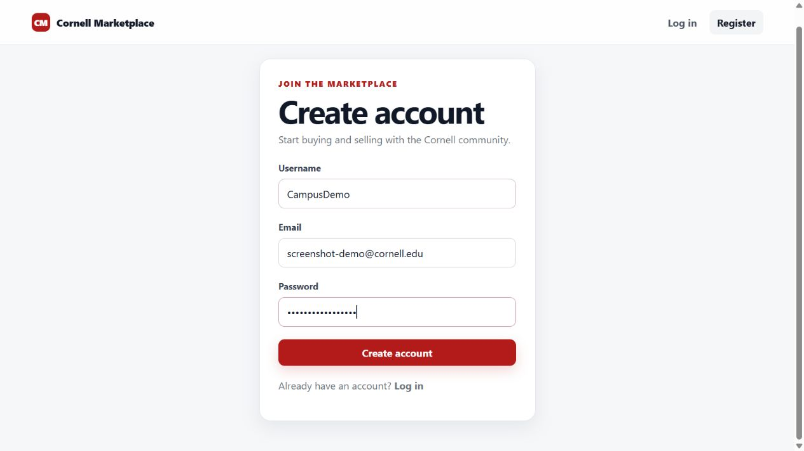
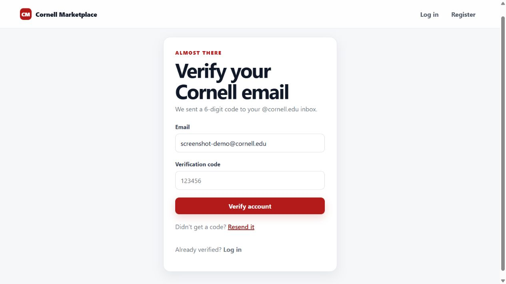
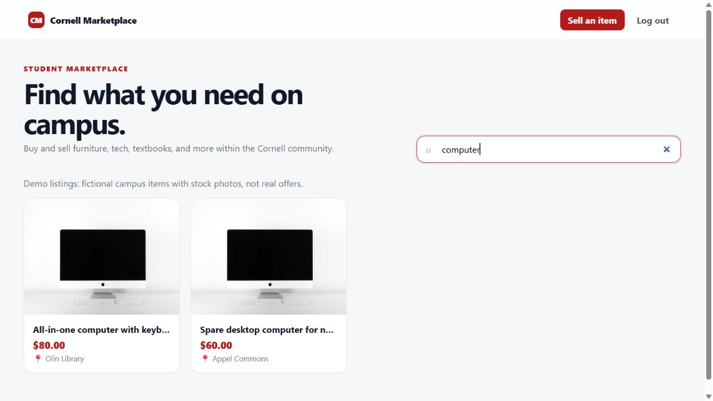

# Cornell Marketplace

A marketplace for Cornell students to post items, search listings, and upload photos. Accounts require Cornell email verification. Sellers can edit and delete their own listings.

React, TypeScript, Spring Boot, PostgreSQL, and S3.

## Screenshots

Local demo from October 11, 2026: 12 fictional listings with stock photos, plus account registration and verification. Verification emails were captured locally, not sent to Cornell.






## Try the demo

Requires Java 17, Node 24, Python, and [uv](https://docs.astral.sh/uv/). Run these in separate terminals from the repo root:

```bash
uv run --with aiosmtpd --no-project python scripts/demo_mailbox.py
```

```bash
python scripts/seed_data.py
```

```bash
cd frontend
npm ci
npm run dev
```

Open the Vite URL. Register a fictional `@cornell.edu` address and enter the code printed by the mailbox.

The demo runs locally with an in-memory H2 database. Restarting clears accounts and reseeds listings. Photos and data are labeled as examples. Uploads still need S3. Do not use the demo profile publicly: its JWT key is test configuration.

## Full setup

Use Java 17, Node 24, PostgreSQL, S3, and an SMTP sender. Set the variables from [backend/.env.example](backend/.env.example) in your shell; Spring Boot does not load `.env` automatically.

| Service | Variables |
| --- | --- |
| Database | `DB_URL`, `DB_USERNAME`, `DB_PASSWORD` |
| Auth | `JWT_SECRET` |
| Photos | `AWS_ACCESS_KEY`, `AWS_SECRET_KEY`, `AWS_BUCKET`, `AWS_REGION` |
| Email | `MAIL_HOST`, `MAIL_PORT`, `MAIL_USERNAME`, `MAIL_PASSWORD`, `MAIL_FROM` |

`JWT_SECRET` must be a Base64-encoded random key of at least 32 bytes. Tokens default to one hour.

```powershell
cd backend
.\mvnw.cmd spring-boot:run
```

In another terminal:

```bash
cd frontend
npm ci
npm run dev
```

On macOS/Linux, use `bash ./mvnw spring-boot:run`. Registration needs working email delivery.

## Checks

```powershell
cd backend
.\mvnw.cmd test
cd ../frontend
npm test
npm run build
npm run lint
```

On macOS/Linux, use `bash ./mvnw test`. Tests use H2 and mocked email/S3 calls; they do not verify production services.

## Hosting and limits

Set `VITE_API_URL` to the backend origin, without `/api`, before building. Set `CORS_ALLOWED_ORIGINS` to the frontend origin. The development proxy does not run in production.

There is no messaging or checkout. Search only matches listing titles, and results are unpaginated. Database changes use Hibernate `ddl-auto=update`, not versioned migrations.
